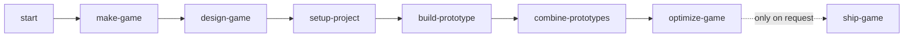

# Blacksite Engine

**A browser game engine for making high-quality, high-performance desktop and mobile games with agents.**

Browser games often start without the defaults that larger engines provide: performance budgets, loading stages, character control, combat, AI, and destruction. Blacksite packages these systems with a CLI and agent skills that turn a game idea into small playable prototypes, combine proven mechanics, and keep the result within a budget. Desktop 120 fps and sustained mobile 60 fps are targets; the automatic scaling work that supports them is on the roadmap.

## Quickstart

```sh
curl -fsSL https://raw.githubusercontent.com/btn0s/blacksite/main/install.sh | sh
```

The installer clones this repository into `~/.blacksite`, installs its workspace dependencies, and links `blacksite` on your PATH. Ask your agent to start Blacksite or invoke `/blacksite:start`. It opens with **“What would you like to do?”** You can also invoke `/blacksite:make-game <idea>`. On Windows, run [install.ps1](install.ps1) in PowerShell. An agent can follow [AGENTS.md](AGENTS.md). Owned assets are optional: connect them later in your own terminal with `blacksite assets login fab|itch|all`, then `blacksite assets sync`.

## What's in the box

| System or platform piece | Purpose | Status |
| --- | --- | --- |
| ALS Web / TPP | Animated third-person character and camera | Usable |
| Subject FPP / Armory | Arms-only first-person input and deterministic weapons | Usable |
| Warden | Squad AI and tactical simulation | Experimental |
| Cascade | Structural destruction and effects | Experimental |
| Input / UI | Device input and a stock neutral game frame | Usable |
| CLI / skills | Scaffold, prototypes, budgets, assets, agent phases | Usable |
| Asset pipeline | Owned Fab metadata, fetch, export, meshopt/KTX2 install | Experimental |
| Relay (`@blacksite/relay`) | Multiplayer rooms: Colyseus, offline loopback, owner movement, server-checked hits | Usable v0 |
| Scale profiles / significance | Automatic quality and update-rate defaults | Planned |

## How it works



Each phase writes its handoff to the game project and runs a checkable gate. The generated Vite shell includes R3F, Rapier, Koota, XState, Effect, a menu, pause and settings screens, GameFrame, and a developer prototype menu. `blacksite scaffold --profile blank|tpp|fpp|mp --name "My Game" --dir /absolute/path --json --gate` keeps the NDJSON contract. `blacksite prototype new <name> [--with als-tpp|fpp|warden|cascade]`, `list`, and `promote` manage modes under `src/prototypes/` and `src/game/`. `blacksite --help` shows the complete command tree.

## Player templates

| Profile | Use when | Current state |
| --- | --- | --- |
| `fpp` | Single-player first person; arms-only `@blacksite/subject-fpp` + Armory, without ALS | Usable |
| `tpp` | Single-player third person; ALS body and camera | Usable |
| `mp` | Multiplayer FPP/TPP; local arms, remote ALS bodies, Colyseus and offline loopback | Usable v0 |
| `blank` | Empty game shell for a custom player | Usable |

The CLI scaffolds `mp` with a local Colyseus room under `pnpm dev`; Play joins through the same-origin `/relay` path and Offline uses loopback. Open a second tab to join the online room. The local camera starts in FPP with rigged ALS arms (rifle and pistol; see [arms](docs/arms.md)), and V switches to TPP while the canvas has focus even without pointer lock; set `cameraMode="fpp"` or `cameraMode="tpp"` on `MultiplayerSubject` to lock a game's camera. Remote players always use ALS bodies, and camera choice stays local. Vite accepts `*.getbb.app` and `*.ts.net` preview hosts by default; `VITE_ALLOWED_HOSTS` adds comma-separated hostnames. `VITE_RELAY_URL` overrides the room endpoint for another deployment topology. [Game architecture](skills/game-architecture/SKILL.md) explains the ownership model and transport choices. For a static two-player demo, mount `LoopbackSplitView` from `@blacksite/subject`; it creates two connections through `createLoopbackRoom()` from `@blacksite/relay` and renders both canvases. Relay v0 has full snapshots, owner movement, and Armory-validated hits; see [Relay limits](packages/relay/AGENTS.md).

## Roadmap

Now: showcase demos, agent guides for every system, touch controls for the player templates, and measurement on reference devices. Next: automatic quality tiers, scale profiles, and workers by default. Later: open worlds, destruction tiers, crowds, network scale, and 2.5D/2D. See [ROADMAP.md](ROADMAP.md).

## Repository layout

`packages/` holds engine systems; `cli/` one-off Node tools; `skills/` agent phases and references; `templates/game-shell/` the generated game; `docs/` integration details; `evals/` agent scenarios.

## Contributing

See [CONTRIBUTING.md](CONTRIBUTING.md) for workspace layout and gates.

## License

Blacksite uses the [Functional Source License 1.1 with Apache-2.0 future license](LICENSE.md). You may use, modify, and ship games with it, including closed-source commercial games. You may not offer Blacksite or a substitute as a competing product. Each release converts to Apache-2.0 two years after that release is made available.
