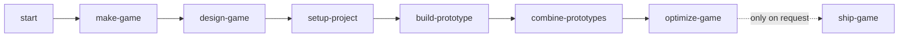

# Blacksite

**Skills and building blocks that let game-dev agents build seriously good browser games.**

A coding agent can write a game loop. What it can't do in an afternoon is write a character with hundreds of animations, multiplayer that feels right, buildings that collapse, or squads that flank you, and keep all of it at 120 fps on a desktop and 60 fps on a phone. Blacksite gives the agent two things:

- **Skills** walk the agent from your idea to a playable game: design it with you, set up the project, prototype each risky mechanic, combine what works, then optimise. Every building block also has a guide, so the agent uses it the right way instead of guessing.
- **Building blocks** are finished game systems the agent snaps together instead of writing from scratch.

You describe the game. The agent builds it with these.

[See the demos](https://blacksite-sable.vercel.app)

## Quickstart

```sh
curl -fsSL https://raw.githubusercontent.com/btn0s/blacksite/main/install.sh | sh
```

Then ask your agent to start Blacksite, or run `/blacksite:make-game <your idea>`. The installer clones this repository into `~/.blacksite` and puts `blacksite` on your PATH. On Windows, run [install.ps1](install.ps1) in PowerShell. An agent installing it can follow [AGENTS.md](AGENTS.md).

## Skills

| Skill | What the agent does with it |
| --- | --- |
| `start` | Asks what you want to do and routes to the right skill. |
| `make-game` | Runs the whole flow below from one idea, picking up where it left off. |
| `design-game` | Interviews you one question at a time: fantasy, core loop, camera, scope, performance budget. |
| `setup-project` | Creates the game project from a player template and checks it runs. |
| `build-prototype` | Builds one risky mechanic on its own, playable from a developer menu. |
| `combine-prototypes` | Joins the mechanics that worked into one core loop. |
| `optimize-game` | Measures the game and brings it within its budget. |
| `ship-game` | Deploys the game, only when you ask. |
| `als`, `game-architecture`, `game-assets`, `blacksite-kit` | Reference the agent loads when it needs it: how to drive characters, how the game is wired, how to use assets you own, what blocks exist. |



Each step writes a handoff into the game project and ends with a check the agent has to pass, so you can stop and resume anywhere.

## Building blocks

| Block | What it gives your game | Status |
| --- | --- | --- |
| [Player templates](docs/player-templates.md) | Ready-to-play starting points: `fpp` (first person), `tpp` (third person), `mp` (multiplayer, switch views with V), `blank` | Usable |
| Characters (ALS Web) | A full animated character: walk, run, sprint, crouch, mantle, roll, ragdoll, aim. A port of ALS Refactored. | Usable |
| First-person arms | Rigged, animated arms holding a rifle or pistol | Usable |
| Weapons (Armory) | Firing, reloading, aiming and recoil, with hits the server can check | Usable |
| Multiplayer (Relay) | Rooms on Colyseus, or in one browser tab for demos and tests; other players animate like the local one | Usable v0 |
| Destruction (Cascade) | Concrete buildings that crack and collapse, simulated off the main thread | Experimental |
| AI (Warden) | Squads that take cover, flank and coordinate | Experimental |
| Input and UI | Keyboard, mouse, gamepad and touch; menus, pause and settings screens | Usable |
| Assets | Use art you already own from Fab or itch.io, compressed for the web | Experimental |

Every project also gets the same base: React Three Fiber for rendering, Rapier for physics, Koota for game state, XState for flow, Effect for services, Vite for the dev server.

## Using the CLI directly

Agents call these for you, but you can too:

- `blacksite scaffold --profile fpp|tpp|mp|blank --name "My Game" --dir /absolute/path` creates a game.
- `blacksite prototype new <name> [--with als-tpp|fpp|warden|cascade]` adds a prototype; `list` and `promote` manage them.
- `blacksite assets login fab|itch|all`, then `blacksite assets sync`, connects art you own.
- `blacksite --help` lists everything.

## Roadmap

Now: demos for every block, guides for the remaining blocks, touch controls for the player templates, and measurement on real devices. Next: automatic quality settings, so games hold their frame rate on any device without extra work. Later: open worlds, bigger destruction, crowds, larger multiplayer, and 2.5D/2D. See [ROADMAP.md](ROADMAP.md).

## Repository layout

`skills/` holds the skills; `packages/` the building blocks; `templates/` the player templates and game shell; `cli/` the `blacksite` command; `site/` the demo site; `docs/` longer guides; `evals/` agent test scenarios.

## Contributing

See [CONTRIBUTING.md](CONTRIBUTING.md) for workspace layout and gates.

## License

Blacksite uses the [Functional Source License 1.1 with Apache-2.0 future license](LICENSE.md). You may use, modify, and ship games with it, including closed-source commercial games. You may not offer Blacksite or a substitute as a competing product. Each release converts to Apache-2.0 two years after that release is made available.
