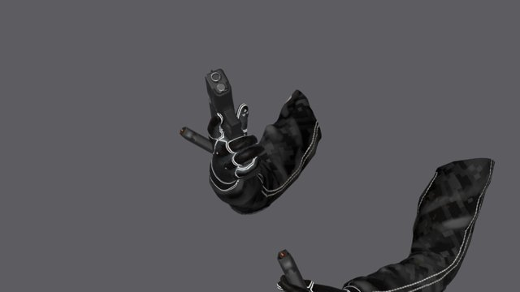
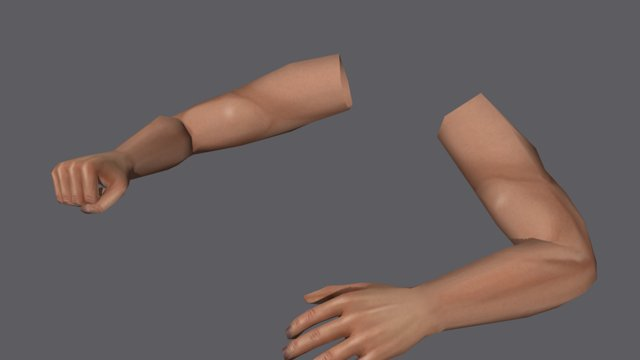
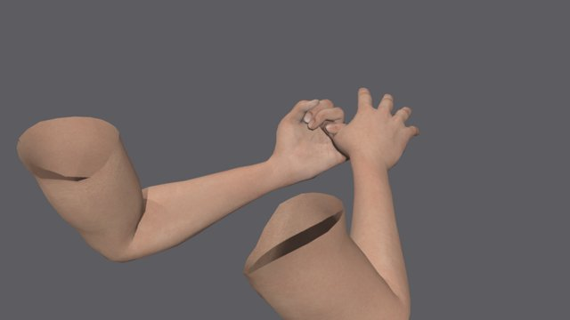
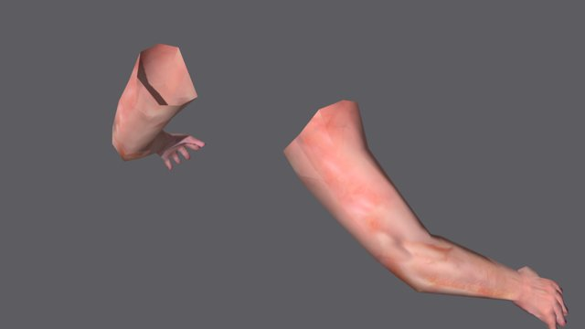

# Viewmodel asset research

Checked 16 October 2026. The brief permits CC0, public domain and CC BY art, including raw files distributed with an open repository. This review traces component credits instead of trusting a combined model's licence badge. The complete CC0 and CC BY legal texts are retained in [the arms package](../packages/subject-fpp/assets/arms/licenses/).

The strongest obtainable found animation set is **1Matzh's 9mm Pistol**, and it is the Firing Range's optional comparison. It is a pistol demonstration, not a complete rifle-and-pistol replacement. The recommended production direction is the controllable CC0 Build route, subject to the runtime, visual and feel gates in the viewmodel report. Legacy ALS is retained for body matching, not counted as the Find-track winner.

## Downloaded shortlist

These are local inspection renders of downloaded files, recovered from the stopped thread and read again during takeover. The portable thumbnails are reduced to 640 × 360 JPEGs; the original PNGs remain with the report captures. Each row supplies the depicted asset's author, source and licence. They show asset construction, not proof of correct in-game framing. Runtime contact sheets belong in the final report.

| Candidate | Licence and source | Included animation | Assessment |
| --- | --- | --- | --- |
| **9mm Pistol — 1Matzh** | [CC BY 4.0](https://sketchfab.com/3d-models/9mm-pistol-first-person-animations-c26d7f5aa72f4b01a6da4578caa8f07f). Urpo's pistol and Blue Spirit's arms source independently verified CC BY. | Downloaded file has `Idle`, `Walk`, `Run`, `Fire`, `Reload`, `Reload_Empty`. | Best complete, obtainable firearm animation comparison. Detailed fabric/gloves and coordinated magazine work. Pistol only; no authored equip, holster, ADS or inspect in this file. Heavy source rig makes it a poor immediate default. |
| **PSX First Person Arms — Drillimpact** | [CC0, author's release](https://drillimpact.itch.io/psx-first-person-arms-free). | Relax, pushes, jabs, guard, grabs, finger-gun and knife actions; 18 exported actions including rest. | Clean retro shape, hand-painted bare/glove alternatives at 512 pixels. Good low-cost mesh base, but no physical rifle/pistol reload animation. |
| **fps arms (rigged only) — para** | [CC0, author's OpenGameArt release](https://opengameart.org/content/fps-arms-rigged-only). Credits MakeHuman mesh/texture. | T-pose and a crude sample action; arm IK and finger curl controls. | More anatomical than the very low-poly candidates, about 8,000 triangles. Unclothed and unfinished as a weapon system; adapting it would duplicate the Build track. |
| **WRAD ARMS — wriks** | [CC0, author's repository and full licence](https://github.com/wwwriks/wrad-arms). | No exported animation clips; IK rig in the source. | About 1,200 triangles and two 512-pixel skin textures. Clear original-author release; visual inspiration is not a copied game model. Low-poly silhouette and bare forearms need substantial adaptation for the target look. |

### 1Matzh pistol

The inspection camera exposes the sleeves and two magazines during reload; it also makes the open sleeve ends obvious. Those ends must stay outside the gameplay camera. The found file should be judged in its authored first-person view before comparing it with the Build rig.

### Drillimpact

The angular elbow and very broad forearm planes suit a more severe retro style. Individual fingers are present, but no firearm contact is demonstrated by the supplied animation set.

### para

The hands have useful anatomy and skin detail. Bare skin, exposed upper-arm cuts and sample-only motion mean this is a mesh source, not a ready FPS presentation.

### WRAD

The pronounced facets are a deliberate low-polygon choice. For this project's fabric and glove direction, dressing and re-posing it would still require our own animation system.

## Found-pistol provenance and conversion

The component trail is verified through the [official Sketchfab model API](https://api.sketchfab.com/v3/models/c26d7f5aa72f4b01a6da4578caa8f07f). A minimal snapshot of the licence fields for each source is retained in [Sketchfab-provenance.json](../packages/subject-fpp/assets/arms/licenses/Sketchfab-provenance.json).

| Component | Author | Source licence |
| --- | --- | --- |
| Animation and assembly | [1Matzh](https://sketchfab.com/1Matzh) | [9mm Pistol / First Person Animations, CC BY 4.0](https://sketchfab.com/3d-models/9mm-pistol-first-person-animations-c26d7f5aa72f4b01a6da4578caa8f07f) |
| Pistol mesh and textures | [Urpo](https://sketchfab.com/Urpo) | [9mm Pistol, CC BY 4.0](https://sketchfab.com/3d-models/9mm-pistol-30222f9a59104426ba526a6b20cd7532) |
| Arms, gloves and sleeves | [Blue Spirit](https://sketchfab.com/Blue-Spirit) | [Modern Soldier, CC BY 4.0](https://sketchfab.com/3d-models/modern-soldier-358b4fb07f0146cb9b9063342db5897a), edited by 1Matzh |
| Original showcase sky, not in the shipped meshes | [fangzhangmnm](https://sketchfab.com/fangzhangmnm) | [sky dome demo, CC BY 4.0](https://sketchfab.com/3d-models/sky-dome-demo-a5778d3c90e644e2be1062895ccd44aa), itself using Poly Haven's CC0 Je Gray Park HDRI |

The stopped thread had a 27,823,784-byte GLB and its original glTF/binary/textures. This takeover imported the glTF, preserved the six actions, removed an unrelated preview object, resized maps to 512 pixels and exported JPEG quality 85. The comparison GLB is 3,938,956 bytes, with five meshes and roughly 928 joints. It is served at `/viewmodel/found-pistol.glb` and should load only when selected. It is not included in generated games by default. The author's current API advertises more animations than the downloaded version contains; only the six actually inspected are claimed. [Full attribution, changes and warranty disclaimer](../site/public/viewmodel/CREDITS.md).

## Search coverage and exclusions

| Source | Finding and decision |
| --- | --- |
| Sketchfab | Checked downloaded CC0/CC BY arm and animation results, plus component pages. **Barcode Games' [M4 animation pack](https://sketchfab.com/3d-models/m4-fps-weapon-animations-pack-v1-662fc74dda2646cfb48fc610705768ef)** is a promising CC BY rifle alternative with draw, fire, reload, empty reload and holster. The unauthenticated official download endpoint returned HTTP 401, so its files and component provenance were not validated and it is not shipped. |
| Sketchfab, Cransh | The downloaded [AK-74m](https://sketchfab.com/3d-models/fps-ak-74m-animations-94be8385c402474cacd39bc096c6ca14) and [rifle pack](https://sketchfab.com/3d-models/animated-fps-hands-rifle-animation-pack-5f2d0ed780a94724b36ab505f7564057) have useful draw/fire/reload/run/inspect motion, but credit DJMaesen's **[FP Arms](https://sketchfab.com/3d-models/fp-arms-8416c380544949bb9b224278819cbe6b)**, currently CC BY-NC. The assembly's CC BY badge cannot remove that restriction. Rejected; no component or motion is copied into the repository. |
| OpenGameArt | para's CC0 mesh is a viable base. [Robin Lamb's rifle and hands](https://opengameart.org/content/low-poly-fps-rifle-and-hands) is CC0 but only supplies a shooting action. The search also produced useful separate weapon geometry rather than complete FPS arms. |
| Open-source templates | [GDQuest's FPS-arm demo licence](https://github.com/gdquest-demos/godot-4-FPS-arms/blob/main/LICENSE) separates MIT code from CC BY-NC-SA art: rejected. [bukkbeek's template](https://github.com/bukkbeek/GodotFPS-Template) adds an asset resale prohibition, so it does not meet the permitted art-licence list. [WRAD](https://github.com/wwwriks/wrad-arms) has an explicit CC0 asset licence and is eligible. No game-code licence is treated as an asset licence. |
| Quaternius | [Animated Guns Pack](https://quaternius.com/packs/animatedguns.html) is CC0 with movable weapon parts, but no arms. The downloaded pistol has slide/trigger/magazine bones and fire/reload clips. Its file named `Rifle` is a wood-stock rifle, not an assault rifle despite the broad source tags; it is not used to stand in for a 600-RPM assault rifle. [Universal Animation Library](https://quaternius.com/packs/universalanimationlibrary.html) is CC0 full-body motion, not an authored first-person hand-to-magazine solution. |
| Kenney | [Blaster Kit](https://kenney.nl/assets/blaster-kit) is CC0 and animated. Its stylized science-fiction weapons do not solve anatomical arms or this project's grounded industrial look. |
| Poly Haven | [CC0 policy](https://polyhaven.com/license) explicitly permits raw redistribution. [Service Pistol](https://polyhaven.com/a/service_pistol), by Mateusz Sadek, has worn PBR surfaces and detachable magazines, about 28,000 triangles. A strong weapon upgrade candidate, but no FPS arms or authored reload set. No complete FPS-arm set was located. |
| Fab | Searched first-person arms and animation listings for explicit CC BY terms. [First Person Arms](https://www.fab.com/listings/8d54275e-f018-4cad-bbb2-14e12e5a3f6e) and [First Person Arms And Weapons Pack](https://www.fab.com/listings/7fa65ae4-ca62-4dd2-b5fd-6ddc3f5f5536) did not expose an eligible CC BY grant in the accessible listing. No Fab Standard assets were downloaded or shipped. This is a search limitation, not a claim that no eligible listing exists. |

## Build provenance and weapon choices

The [official MPFB licence](https://github.com/makehumancommunity/mpfb2/blob/master/LICENSE.md) separates its program code from its CC0 base meshes, targets, rigs, poses and textures. It explicitly includes graphical data generated through scripts. The recovered `build_arms.py` calls the bundled human generator and built-in game skeleton; it does not load any purchased or community clothing. Our sleeve mesh and grip/weapon curves are original work. [Package provenance](../packages/subject-fpp/assets/arms/CREDITS.md) records the exact sources.

The default rifle uses **[AKM by LonesomeDucky](https://opengameart.org/content/akm)**, CC0, weathered and PBR textured. The downloaded source is a 0.972-metre weapon with 5,322 polygons and embedded base-colour, normal, metalness, roughness and AO maps. Blacksite adds magazine/charging-handle part weights and reduces textures to 1024 pixels. The default pistol uses Quaternius's source with ambientCG surfaces. A secondary CC0 option, **[Soviet Assault Rifle by GGBotNet](https://opengameart.org/content/soviet-assault-rifle-3d)**, is only 2,277 triangles but has no texture and was not selected. Sources came from the authors' direct OpenGameArt releases, not from owned asset stores. [Weapon conversion provenance](../packages/subject-fpp/assets/weapons/CREDITS.md).

The build route controls weapon sockets, two-bone hand targets, finger poses and timings across both weapons. That solves more of the brief than a single attractive pistol clip pack. It is a design recommendation, not a substitute for reading reload/equip contact sheets, checking grip continuity and passing measured runtime gates.
